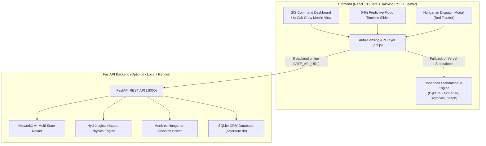

# 🛡️ RakshaPath | रक्ष पथ
### National Emergency Mobility Network • Tactical Evacuation & Rescue Routing

[](https://fastapi.tiangolo.com/)
[](https://react.dev/)
[](https://vitejs.dev/)
[](https://tailwindcss.com/)
[](https://leafletjs.com/)
[]()
[](https://opensource.org/licenses/MIT)

**RakshaPath** is an autonomous tactical emergency routing and fleet dispatch platform engineered for disaster response authorities (NDRF, SDRF, EMS, Civil Defense) and citizens. During severe monsoonal floods, cloudbursts, and urban inundations, standard civilian navigation tools (Google Maps, OpenStreetMap) route vehicles into impassable or fatal waterlogged underpasses and collapsed river bridges. RakshaPath computes **physical-risk-weighted safe corridors** and **geographically diverse backup routes** using hydrological prediction, soft-sigmoid vehicle passability models, and bipartite Hungarian fleet dispatching.

---

## 🏗️ System Architecture



---

## 🌟 Core Advanced Capabilities

### 1. Zero-Backend Vercel Standalone Resilience
The production frontend (`https://rakshapath-live.vercel.app`) features a **zero-dependency embedded client-side engine** (`frontend/src/engine/`). If `VITE_API_URL` is omitted or an external backend is sleeping/offline, the application runs **100% in-browser**:
- Client-side graph routing and diverse backup corridor generation.
- Full soft-sigmoid passability evaluation.
- In-memory Hungarian bipartite dispatch solver with hospital bed decrement.
- Zero blank screens, infinite resilience. When a FastAPI backend connects, it automatically detects and synchronizes with it.

### 2. Predictive Flood Timeline (0–6 Hours)
- Interactive time-scrubber with **Light**, **Heavy**, and **Extreme Surge (280mm/24h)** precipitation scenarios.
- Hydrological water-rise curve projections across low-elevation riverbanks and urban underpasses.
- Live passability status updating hour-by-hour with automated route recalculation.

### 3. Soft-Sigmoid Vehicle Passability Curves
Unlike binary cutoff models, RakshaPath models vehicle water traversal using a parameterized logistic sigmoid function:
$$P(d) = \frac{1}{1 + e^{k \cdot (d - d_{\text{safe}})}}$$
- **Ambulance:** $d_{\text{safe}} = 25\text{ cm}$, $k = 0.18$ (engine stall hazard at low clearance).
- **NDRF Heavy Truck:** $d_{\text{safe}} = 70\text{ cm}$, $k = 0.12$ (ruggedized air intake).
- **Flood Boat (Amphibious):** Inverted curve thriving in deep water ($> 20\text{ cm}$), grounded on dry land.
- **Rapid Response 4x4 & Evacuation Bus:** Specific mechanical clearance thresholds.

### 4. Dual Safe Corridors & Reliability Scoring
- **Primary Corridor (Solid Emerald):** Optimal risk-weighted A* path.
- **Backup Corridor (Dashed Sky Blue):** Geographically diverse secondary route computed by penalizing primary edges to ensure non-overlapping transit chokepoints.
- **Reliability Score ($R$):** Product of segment passabilities $R = \prod_{e} P_e$.

### 5. Plain-Language Turn-by-Turn Explanations
Every generated route features plain-language justifications explaining **why** specific detours were chosen:
> *"Taking Shastri Bridge Embankment (+2.8 km detour) to bypass 72 cm waterlogged low-line causeway."*

### 6. Pan-India Command Center (7 Calibrated Zones)
Instantaneous high-speed camera jumps to major Indian flood vulnerability zones:
- **Prayagraj (UP):** Sangam Ganga-Yamuna monsoonal surge & bridge corridors.
- **Delhi NCR:** Yamuna riverfront causeways & ITO underpass inundation.
- **Patna (Bihar):** Ganga basin discharge & medical relief centers.
- **Guwahati (Assam):** Brahmaputra monsoon cresting & hill routes.
- **Mumbai (Maharashtra):** Mithi river tidal surge & coastal arteries.
- **Chennai (Tamil Nadu):** Adyar & Cooum river storm runoff.
- **Kolkata (West Bengal):** Hooghly river tidal inundation.

### 7. Multi-Asset Hungarian Dispatch with ICU Bed Verification
- Solves bipartite matching minimizing arrival latency and penalizing depth mismatches.
- Wading clearance checks ensure ambulances are never dispatched to deep water.
- Tracks receiving hospital **free ICU beds** in real-time and decrements capacity, eliminating zero-bed diversion bottlenecks.
- Full manual override controls for dispatch commanders.

### 8. In-Cab Crew Mobile View & 1-Tap Failover
- Responsive mobile terminal designed for ambulance and rescue truck drivers.
- **1-Tap "ROAD BLOCKED" Button:** Immediately triggers instant failover to the pre-computed Backup Corridor if an unexpected tree fall or bridge collapse is encountered on-scene.

---

## 🚀 Deployment on Vercel

The repository includes a root `vercel.json` configured for zero-configuration Vite deployment:

### Exact Vercel Project Settings:
- **Framework Preset:** `Vite`
- **Root Directory:** `./` (Leave as root)
- **Build Command:** `cd frontend && npm install && npm run build`
- **Output Directory:** `frontend/dist`
- **Install Command:** *(Leave default or leave empty)*
- **Environment Variables (Optional):**
  - `VITE_API_URL`: URL of your deployed FastAPI backend (e.g. on Render or Railway). If left blank, the frontend operates seamlessly via its embedded client engine!

### Vercel CLI Deployment:
```bash
# Deploy to preview
vercel

# Deploy to production
vercel --prod
```

---

## 💻 Local Development Setup

### Option 1: Running with Docker Compose (Recommended)
```bash
docker-compose up --build
```
- Frontend: `http://localhost:3000`
- Backend API: `http://localhost:8000` (Docs: `http://localhost:8000/docs`)

### Option 2: Running Services Separately

#### 1. Backend (FastAPI)
```bash
# Create virtual environment
python -m venv venv
venv\Scripts\activate       # Windows
# source venv/bin/activate  # macOS / Linux

# Install dependencies
pip install -r backend/requirements.txt

# Start FastAPI server
python -m uvicorn backend.main:app --host 0.0.0.0 --port 8000 --reload
```

#### 2. Frontend (React + Vite)
```bash
cd frontend
npm install
npm run dev
```
Open `http://localhost:5173` in your browser.

---

## 🧪 Automated Testing

RakshaPath includes a comprehensive 24-test Pytest suite covering vehicle physics, sigmoid monotonicity, hazard calculations, A* routing, Hungarian matching, bed decrementing, and REST endpoints:

```bash
python -m pytest backend/tests/test_rakshapath.py -v
```

```
collected 24 items
backend/tests/test_rakshapath.py::test_vehicle_profiles_structure PASSED        [  4%]
backend/tests/test_rakshapath.py::test_sigmoid_dry_road_passability PASSED      [  8%]
backend/tests/test_rakshapath.py::test_sigmoid_deep_water_passability PASSED    [ 12%]
backend/tests/test_rakshapath.py::test_flood_boat_amphibious_physics PASSED     [ 16%]
backend/tests/test_rakshapath.py::test_passability_monotonicity PASSED          [ 20%]
backend/tests/test_rakshapath.py::test_haversine_identical_coordinates PASSED  [ 25%]
backend/tests/test_rakshapath.py::test_haversine_delhi_to_lucknow PASSED        [ 29%]
backend/tests/test_rakshapath.py::test_hazard_risk_safe_conditions PASSED      [ 33%]
backend/tests/test_rakshapath.py::test_hazard_risk_extreme_water PASSED         [ 37%]
backend/tests/test_rakshapath.py::test_hazard_damage_component_penalty PASSED  [ 41%]
backend/tests/test_rakshapath.py::test_emergency_router_initialization PASSED  [ 45%]
backend/tests/test_rakshapath.py::test_find_safe_corridor_success PASSED       [ 50%]
backend/tests/test_rakshapath.py::test_dual_corridor_reliability_scores PASSED [ 54%]
backend/tests/test_rakshapath.py::test_find_nearest_node_lookup PASSED          [ 58%]
backend/tests/test_rakshapath.py::test_router_hazard_impact_and_detour PASSED  [ 62%]
backend/tests/test_rakshapath.py::test_dispatch_assignment_matching PASSED     [ 66%]
backend/tests/test_rakshapath.py::test_dispatch_wading_safety_rejection PASSED  [ 70%]
backend/tests/test_rakshapath.py::test_dispatch_hospital_bed_decrement PASSED  [ 75%]
backend/tests/test_rakshapath.py::test_api_root_status PASSED                   [ 79%]
backend/tests/test_rakshapath.py::test_api_states_endpoint PASSED               [ 83%]
backend/tests/test_rakshapath.py::test_api_shelters_endpoint PASSED             [ 87%]
backend/tests/test_rakshapath.py::test_api_hazard_evaluation_post PASSED        [ 91%]
backend/tests/test_rakshapath.py::test_api_route_calculation_endpoint PASSED   [ 95%]
backend/tests/test_rakshapath.py::test_api_dispatch_optimize_endpoint PASSED   [100%]
============================== 24 passed in 1.30s ===============================
```

---

## ⚖️ Synthetic vs Real Data & Known Limitations

1. **Hydrological Water Levels**: In the live simulation and standalone engine, water depth values and timeline trajectories are mathematically modeled using real elevation contours and synthetic monsoonal precipitation scenarios. In an active production deployment with municipal agencies, these endpoints can ingest live telemetry from Central Water Commission (CWC) telemetry gauges and IMD Doppler radar feeds.
2. **Road Network Graph**: Pilot regional graphs (Prayagraj, Delhi NCR, Lucknow, etc.) are calibrated with real coordinates and critical river crossings. Full pan-India production deployments utilize OpenStreetMap road extraction via OSMnx or Overpass API.
3. **Hospital Bed Availability**: Bed counts and ICU status are simulated for demonstration triage; production use connects to state Ayushman Bharat Digital Mission (ABDM) or NDMA hospital bed registries.

---

## 📄 License
This project is licensed under the MIT License. See [LICENSE](LICENSE) for details.
